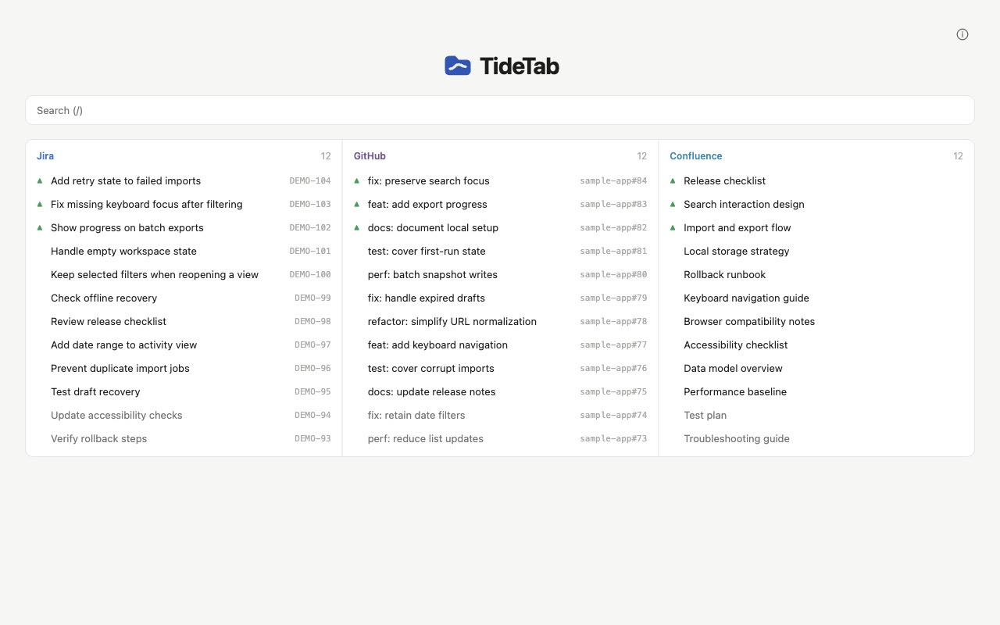

#  TideTab

[简体中文](README.zh-CN.md)

**Your new tab moves with the tide of your work.**

The Jira issue you keep reopening, the pull request you're reviewing, the Confluence page you keep coming back to: they rise on your Chrome new tab as you use them. When you move on to the next project, those links recede and the ones you need now rise in their place. TideTab uses your browsing history, so there's nothing to bookmark or rearrange.



## How it works

- Jira, GitHub, and Confluence each get a column. GitHub pull requests rank separately from repositories; Files and Commits views of the same pull request count toward one link.
- Press `/` to search by title, issue key, PR number, or URL. Press Enter to open the first result.
- The interface follows Chrome’s display language: English, Simplified Chinese, Traditional Chinese, Japanese, or Korean. Other languages fall back to English.

## Try it locally

You need Node.js 22 or newer. From the repository root:

```sh
node --test
node scripts/build-extension.mjs
```

In Chrome, open `chrome://extensions`, turn on **Developer mode**, and select **Load unpacked** → `dist/extension`.

## Privacy

TideTab reads browsing history to rank links. It processes and stores that data in your Chrome profile without uploading it. The [privacy policy](PRIVACY.md) explains what it keeps and how to delete it.

## Development

See the [Chrome Web Store build and release guide](docs/chrome-web-store.md).
