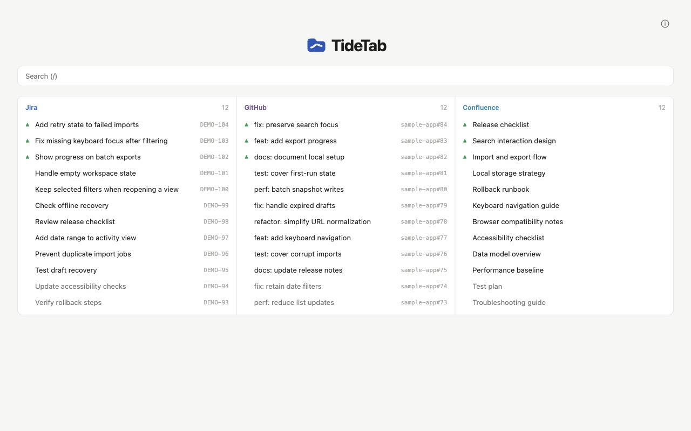

#  TideTab

[English](README.md)

**常用链接浮上来，做完的项目慢慢退潮。**

这几天反复打开的 Jira 工单、正在审的 GitHub PR、讨论时总要翻的 Confluence 文档，都会浮到 Chrome 新标签页的前面。等你转去做下一个项目，旧链接会慢慢退下去，给手头常用的页面让出位置。TideTab 根据浏览历史排列这些链接，不用提前收藏，也不用事后整理。



## 使用方式

- Jira、GitHub 和 Confluence 各占一栏。GitHub PR 和仓库分开排列；同一个 PR 的 Files 和 Commits 页面合并为一个入口。
- 按 `/` 开始搜索，可输入页面标题、工单编号、PR 编号或网址。按 Enter 打开第一条结果。
- 界面跟随 Chrome 的显示语言，支持英文、简体中文、繁体中文、日文和韩文。其他语言回退到英文。

## 本地安装

需要 Node.js 22 或更新版本。在仓库根目录运行：

```sh
node --test
node scripts/build-extension.mjs
```

在 Chrome 打开 `chrome://extensions`，开启「开发者模式」，点击「加载已解压的扩展程序」，选择生成的 `dist/extension` 目录。

## 隐私

TideTab 读取浏览历史来排列链接，只在当前 Chrome 配置中处理和保存这些数据，不会上传。[隐私政策](PRIVACY.md)说明了保存哪些数据，以及如何删除。

## 开发

见 [Chrome 网上应用店打包与发布流程](docs/chrome-web-store.md)。
